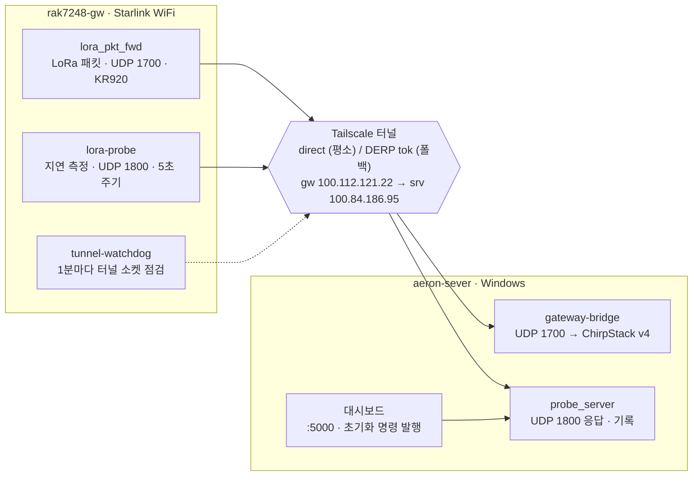

# rak7248-gw 게이트웨이 현황

2026-10-17 기준. 구축 절차는 [rak.md](rak.md), 프로토콜은 [protocol.md](protocol.md) 참고.

rak7248-gw 는 정상 동작 중이다. Starlink 회선에서 Tailscale direct 로 서버에 붙어 있고, 프로브 RTT 중앙값은 178ms 다. 2026-10-17 에 NTP 대기와 프로토콜 v2(대시보드 초기화)를 배포했고, 디스크 사용량을 63% 에서 27% 로 줄였다.

## 하드웨어·네트워크

게이트웨이와 서버는 같은 tailnet 에 있고, 두 노드 모두 키 만료가 꺼져 있어 재로그인이 필요 없다.

| 항목 | 값 |
| --- | --- |
| 장비 | RAK7248 (Raspberry Pi, Debian 11 bullseye arm64), 호스트명 `rak-gateway` |
| 회선 | Starlink WiFi (`wlan0`, 192.168.1.70) |
| Tailscale 노드 | `rak7248-gw` = 100.112.121.22, 소유자 개인 계정, 키 만료 꺼짐 |
| 서버 | `aeron-sever` = 100.84.186.95 (Windows, ChirpStack v4 Docker), 키 만료 꺼짐, direct 연결 |
| 패킷 포워더 | `gateway_ID` 2CCF67FFFE405E3C, KR920 (radio_0 922.4MHz, radio_1 923.0MHz) |
| 시계 | RTC 없음, fake-hwclock + ntpd, NTP 오차 약 1ms |
| 디스크 | 15G 중 3.7G 사용 (27%), journal 상한 300M |

## 데이터 경로

패킷 포워더와 프로브 모두 서버의 Tailscale IP 로 보내므로, 게이트웨이가 tailnet 에서 빠지면 둘 다 끊긴다. 게이트웨이에 떠 있는 로컬 ChirpStack 서비스 3개는 RAK 이미지 기본값이고 이 경로에는 쓰이지 않는다.

## 지연 프로브

배포된 클라이언트는 이 저장소의 [`gateway/probe_client.py`](../../gateway/probe_client.py) (main e0b01f4) 와 같다. 회선이 안정된 뒤 측정값은 RTT 중앙값 178ms, 손실 약 3.5% 다.

| 항목 | 값 |
| --- | --- |
| 서비스 | `lora-probe`, `/opt/lora-probe/probe_client.py` |
| 버전 | 프로토콜 v2 (대시보드 기록 초기화) + 시계 스텝 감지 (1초 넘게 튀면 새 run) |
| 주기 | 5초 (override `PROBE_INTERVAL=5`) → 100.84.186.95:1800 UDP |
| 부팅 시 | NTP 동기화를 최대 5분 대기 ([`gateway/lora-probe-time-sync.conf`](../../gateway/lora-probe-time-sync.conf)) |
| 기록 | `/var/lib/lora-probe/probe_client.db`, 실행한 명령 ID 는 `last_cmd_id` |
| RTT | 중앙값 178ms, p90 207ms |
| 손실 | 약 3.5% (부팅 직후 망 미연결 구간 제외) |
| 끊김 | 15:12~15:21 Starlink 품질 저하, RTT 1~1.8s, 최장 25초 끊김 |

측정값은 2026-10-17 14:58 재부팅 뒤 약 40분치 표본이다. 16:10 대시보드 초기화 이후 기록은 id 1 부터 다시 쌓이고 있다.

## 감시

터널 소켓이 죽으면 두 겹으로 자동 복구하지만, Tailscale 계정 문제(로그아웃·노드 삭제)는 복구하지 못한다.

- **`tunnel-watchdog.timer`:** 1분마다 Tailscale 터널 소켓을 점검한다. 설치 전 드라이런에서 찾은 오탐 2건은 4565c66 에서 고쳤다.
- **프로브 소켓 자가복구:** 3번 연속 실패하면(15초) 소켓을 다시 만들고 경로를 다시 조회한다.

## 작업 기록 (2026-10-17)

재부팅에서 발견한 시계 문제를 고치고, 프로토콜 v2 를 배포·검증했다.

| 시각 | 내용 |
| --- | --- |
| 16:20 | 디스크 정리 63% → 27%: 예전 VS Code 서버 6개(3.7G) 삭제, journal 300M 제한 |
| 16:12 | [PR #1](https://github.com/kimbongdda/chirpstack-docker/pull/1) main 에 머지 (e0b01f4) |
| 16:10 | 대시보드 초기화 검증: 1회만 실행, 3246행 삭제, ack 확인, id 1부터 다시 기록 |
| 16:08 | 프로토콜 v2 와 시계 스텝 감지를 합친 버전 배포 |
| 15:43 | NTP 대기(drop-in) + 시계 스텝 감지 배포 |
| 14:58 | 재부팅 발견. 09-27 이후 꺼져 있었고, 첫 run ID 가 옛 시각(09-27)으로 찍힘 |

## 남은 것·주의할 점

동작은 확인했지만 두 가지 시계 상황은 아직 실제로 겪어 보지 않았고, 두 번째 게이트웨이를 붙이려면 프로브·대시보드를 손봐야 한다.

- [ ] 시계 미동기 부팅 시 5분 대기가 동작하는지 확인 (다음 재부팅 때)
- [ ] 실행 중 시계 스텝 때 run 전환 확인
- [ ] `last_cmd_id` 저장을 원자적 쓰기 + fsync 로 바꾸기 (지금은 정전 시 초기화가 다시 실행될 수 있음)
- [ ] 두 번째 게이트웨이: 패킷 포워딩은 ChirpStack 등록만 하면 되지만, 프로브(`NODE` 이름)와 대시보드(끊김 분석, 초기화 대상)가 `rak7248-gw` 로 고정되어 있음
- [ ] VS Code 업데이트 뒤 예전 서버 버전 정리 (버전당 약 600M)

Tailscale 에서 빠지면 패킷 포워딩도 끊긴다. 게이트웨이를 넘기거나 늘릴 때는 개인 계정 대신 태그 노드(`tag:gateway` auth key)로 넣는 것을 권장한다.
